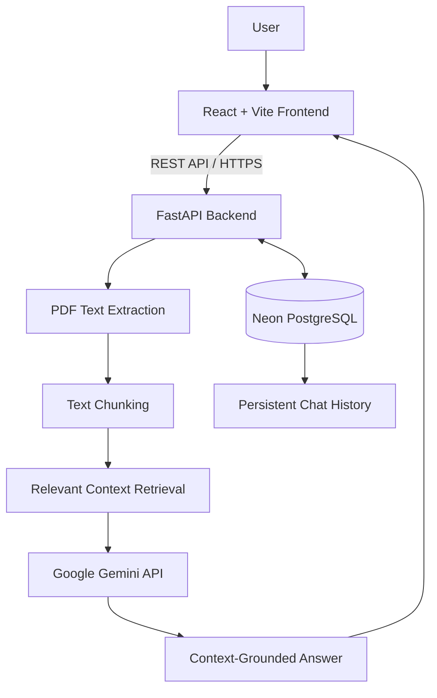
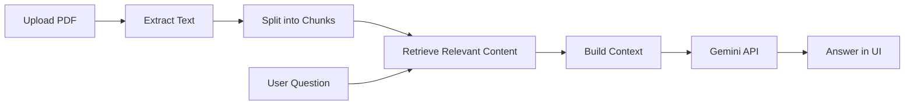

<div align="center">


<p><strong>Turn documents into answers with Retrieval-Augmented Generation (RAG).</strong></p>

<a href="https://docu-mind-wine.vercel.app/"></a>
<a href="https://documind-backend-latest-v4zu.onrender.com/docs"></a>

<p>


</p>
</div>

---

## ✨ Overview

**DocuMind** is an AI-powered document intelligence platform that lets users upload PDF documents and ask questions in natural language. It retrieves relevant document content and uses the Gemini API to generate context-grounded answers through a **Retrieval-Augmented Generation (RAG)** workflow.

## 🚀 Live Links

| Resource | Link |
|---|---|
| **Live application** | [docu-mind-wine.vercel.app](https://docu-mind-wine.vercel.app/) |
| **Backend API** | [Render backend](https://documind-backend-latest-v4zu.onrender.com/) |
| **Interactive API documentation** | [Swagger UI](https://documind-backend-latest-v4zu.onrender.com/docs) |
| **Database** | PostgreSQL hosted on Neon |

## 🎯 Features

- 📄 Upload and manage PDF documents.
- 💬 Ask natural-language questions about document content.
- 🧠 RAG workflow retrieves relevant text before answer generation.
- ✨ Gemini-powered answers based on retrieved context.
- 💾 PostgreSQL-backed persistent conversation history.
- 🗂️ React dashboard for document management and AI assistant workflows.
- 🔌 FastAPI REST backend with interactive Swagger documentation.
- ☁️ Deployed frontend, backend, and database services.

## 🧰 Tech Stack

| Layer | Technologies |
|---|---|
| Frontend |    |
| Backend |    |
| Database |   |
| AI |   |
| Deployment |   |
| Tools |   |

## 🏗️ System Architecture



## 🧠 RAG Workflow



1. **Upload:** The user uploads a PDF.
2. **Extract:** The backend extracts readable text.
3. **Chunk:** Text is split into smaller sections.
4. **Retrieve:** Relevant content is selected for the user's question.
5. **Generate:** The question and retrieved context are sent to Gemini.
6. **Respond:** The answer is returned to the React interface.
7. **Persist:** Chat history is stored in PostgreSQL where supported by the chat workflow.

> This documents the high-level implemented workflow. A specific embedding model or vector database/index is not claimed here.

## 📁 Project Structure

```text
DocuMind/
├── frontend/
│   ├── public/
│   ├── src/
│   │   ├── components/       # Reusable UI components
│   │   ├── pages/            # Pages/views (if separated this way)
│   │   ├── services/         # API helpers (if separated this way)
│   │   ├── App.jsx
│   │   └── App.css
│   ├── package.json
│   └── vite.config.js
├── backend/
│   ├── app/
│   │   ├── api/              # API routes (if organized by module)
│   │   ├── db/               # Database configuration
│   │   ├── models/           # Database models
│   │   └── main.py           # FastAPI entry point
│   └── requirements.txt
├── .github/workflows/        # CI workflows, if configured
└── README.md
```

> Adjust folder names to match your current repository if your local structure differs.

## ⚙️ Run Locally

### Prerequisites
- Node.js and npm
- Python (use the version configured by your project)
- PostgreSQL database (Neon can be used)
- Google Gemini API key

### 1. Clone your repository

```bash
git clone <YOUR_GITHUB_REPOSITORY_URL>
cd DocuMind
```

### 2. Start the backend

```bash
cd backend
python -m venv .venv
```

Activate the environment:

```bash
# Windows PowerShell
.venv\Scripts\Activate.ps1

# macOS / Linux
source .venv/bin/activate
```

Install dependencies and configure environment variables:

```bash
pip install -r requirements.txt
```

Create the environment file expected by your backend (commonly `.env`). Example values:

```env
DATABASE_URL=your_postgresql_connection_string
GEMINI_API_KEY=your_gemini_api_key
```

Use the exact variable names read by your application. Start the API from the backend directory if your entry point is `app.main:app`:

```bash
uvicorn app.main:app --reload
```

API docs: [http://127.0.0.1:8000/docs](http://127.0.0.1:8000/docs)

### 3. Start the frontend

Open a second terminal:

```bash
cd frontend
npm install
```

Create `frontend/.env`:

```env
VITE_API_URL=http://127.0.0.1:8000
```

Ensure your frontend API client uses `VITE_API_URL`, then run:

```bash
npm run dev
```

Vite prints the local URL, usually [http://localhost:5173](http://localhost:5173).

## 🔐 Environment Variables

| Variable | Purpose | Example |
|---|---|---|
| `VITE_API_URL` | Frontend API base URL | `http://127.0.0.1:8000` |
| `DATABASE_URL` | PostgreSQL connection string | Configure privately |
| `GEMINI_API_KEY` | Gemini API access | Configure privately |

Variable names must match your code. Never commit API keys, database passwords, tokens, or private `.env` files.

## 🔌 API Documentation

Explore and test the deployed routes using [DocuMind Swagger UI](https://documind-backend-latest-v4zu.onrender.com/docs). Endpoint names and schemas may change as the project evolves.

## ☁️ Deployment

- **Frontend:** Vercel
- **Backend:** Render
- **Database:** Neon PostgreSQL

Set production environment variables in the hosting dashboards. Point `VITE_API_URL` to the deployed backend URL and rebuild/redeploy the frontend after changing Vite environment variables.

## 🛡️ Security Checklist

- Keep Gemini and database credentials on the backend.
- Validate uploaded files and enforce upload-size limits.
- Apply authentication and authorization to user documents and conversations.
- Configure CORS for trusted frontend origins only.
- Avoid logging secrets or sensitive document contents.

## 🗺️ Roadmap

- [ ] Improve retrieval quality and evaluate answer grounding.
- [ ] Add richer source references in generated answers.
- [ ] Add document search and filtering.
- [ ] Add automated frontend and backend tests.
- [ ] Improve observability for API latency and deployment health.

## 👨‍💻 Author

**Pranav Amale**

- [GitHub](https://github.com/Pranavamale1)
- [LinkedIn](https://www.linkedin.com/in/pranav-amale-210b2b342)

---

<div align="center">

**DocuMind — Ask your documents, not just your search bar.**

<sub>Built with React, FastAPI, PostgreSQL, and Google Gemini.</sub>

</div>
